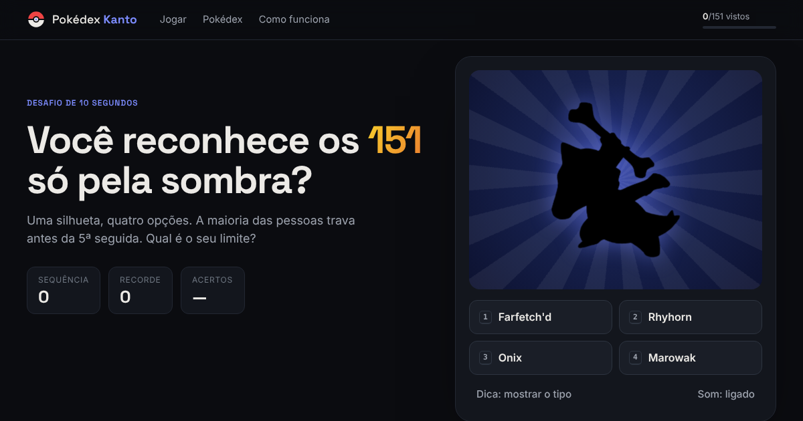
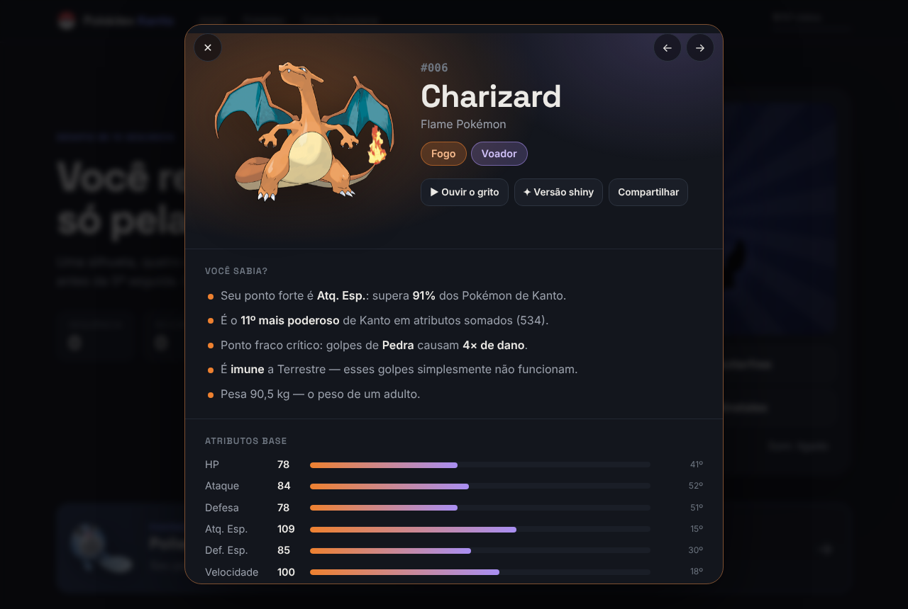

# Quem é esse Pokémon? — Pokédex Kanto

> Você reconhece os 151 Pokémon de Kanto só pela sombra? A maioria das pessoas trava antes da 5ª seguida.

**[▶ Jogar agora — educofseal.github.io/Pokedex](https://educofseal.github.io/Pokedex/)**

[](https://educofseal.github.io/Pokedex/)

`JavaScript puro` · `HTML` · `CSS` · `Node.js` · `PokéAPI` · `GitHub Actions` · `GitHub Pages`

---

## O que tem no site

| | |
|---|---|
| **Quem é esse Pokémon?** | Uma silhueta, 4 opções. Conta sequência, recorde e taxa de acerto. Uma das opções erradas é sempre do mesmo tipo, para não ficar fácil. Atalhos: `1`–`4` e `Enter`. |
| **Pokémon do dia** | Um diferente a cada dia, igual para todo mundo — um motivo para voltar amanhã. |
| **Pokédex dos 151** | Busca por nome, número ou tipo em português (`fogo`, `água`…), filtros por tipo e ordenação por poder, velocidade ou peso. |
| **Ficha completa** | Arte oficial, versão shiny, grito do Pokémon, atributos com ranking, fraquezas calculadas (2× e 4×), cadeia de evolução e curiosidades. |
| **Progresso** | Cada Pokémon aberto ganha um ✓. A barra no topo mostra quantos dos 151 você já viu, com conquistas no caminho. |
| **Links compartilháveis** | Toda ficha tem endereço próprio: [`#/charizard`](https://educofseal.github.io/Pokedex/#/charizard). O botão "Desafiar um amigo" manda seu recorde. |

[](https://educofseal.github.io/Pokedex/#/charizard)

## Como funciona

```
 PokéAPI ──► scripts/build-data.mjs ──► data/pokedex.json ──► server/server.js  (API REST, opcional)
 (≈450 requisições,     roda no GitHub      data/pokedex.js  ──► index.html + app.js (o site)
  uma vez por semana)   Actions
```

1. **Os dados ficam prontos antes de você chegar.** Em vez do navegador fazer centenas de requisições à PokéAPI, um script faz isso uma vez e salva tudo num arquivo de ~100 KB. O site abre com **1 requisição**.
2. **Fraquezas são calculadas, não copiadas.** O site tem a tabela de tipos e multiplica as vantagens: Gelo (2× contra Dragão) × (2× contra Voador) = **4× no Dragonite**.
3. **Curiosidades saem dos números.** "Mais rápido que 80% de Kanto" vem de comparar o atributo com os outros 150. Nenhuma frase foi escrita à mão para cada Pokémon.
4. **O progresso fica no seu navegador** (`localStorage`). Sem login, sem banco de dados.

## Estrutura

```
index.html                 estrutura da página
style.css                  visual (tema escuro, cores oficiais dos tipos, responsivo)
app.js                     jogo, grade, filtros, ficha e curiosidades
data/pokedex.json / .js    dados gerados (não edite à mão)
scripts/build-data.mjs     gera os dados a partir da PokéAPI
server/server.js           backend opcional: serve o site + API REST
.github/workflows/dados.yml atualiza os dados toda semana e testa o backend
```

## Rodar no seu computador

Precisa do **Node 18+** só para o backend e para regerar os dados. O site em si abre direto.

```bash
git clone https://github.com/Educofseal/Pokedex.git
cd Pokedex

# opção 1: só o site — abra o index.html no navegador

# opção 2: site + API
npm start                 # http://localhost:3000

# regerar os dados da PokéAPI
npm run build:data
```

### API (com `npm start`)

| Rota | Retorna |
|---|---|
| `GET /api/pokemon` | Lista dos 151 (id, nome, tipos) |
| `GET /api/pokemon/25` ou `/api/pokemon/pikachu` | Ficha completa |
| `GET /api/pokemon/aleatorio` | Um Pokémon sorteado |
| `GET /api/dia` | O Pokémon do dia (mesmo do site) |
| `GET /api/tipos` | Tabela de vantagens entre tipos |

## Deploy

O site é publicado pelo **GitHub Pages** direto da branch `main` — todo commit vira site novo em cerca de 1 minuto.
O workflow `Atualizar dados da Pokédex` roda toda segunda-feira (ou manualmente em *Actions → Run workflow*), regera os dados e faz commit se algo mudou.

## O que aprendi construindo

- **Paralelismo com limite:** baixar 450 recursos com no máximo 16 ao mesmo tempo, com nova tentativa em caso de falha.
- **Pré-processar em vez de buscar ao vivo:** mover trabalho do navegador para o build deixou o site instantâneo.
- **Event delegation:** um único listener cuida dos 151 cards.
- **`<dialog>` nativo + rotas por hash:** modal acessível (Esc fecha, foco preso) e links que abrem direto na ficha.

## Créditos

Dados e imagens da [PokéAPI](https://pokeapi.co). Projeto de fã, sem fins lucrativos — Pokémon e seus nomes são marcas da Nintendo, Game Freak e Creatures.

## Licença

MIT
